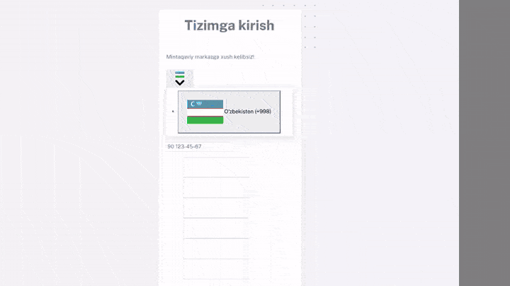
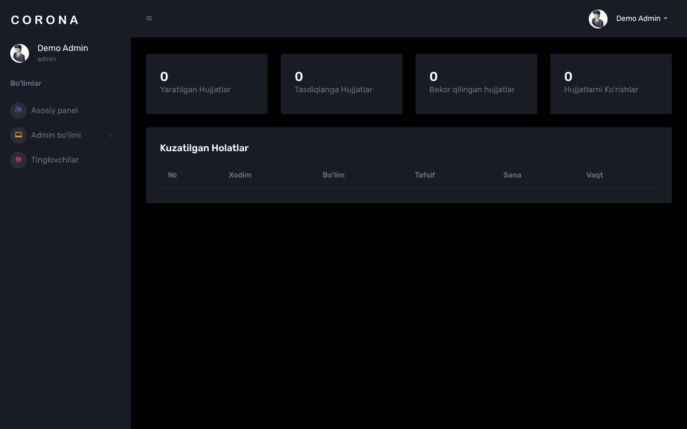
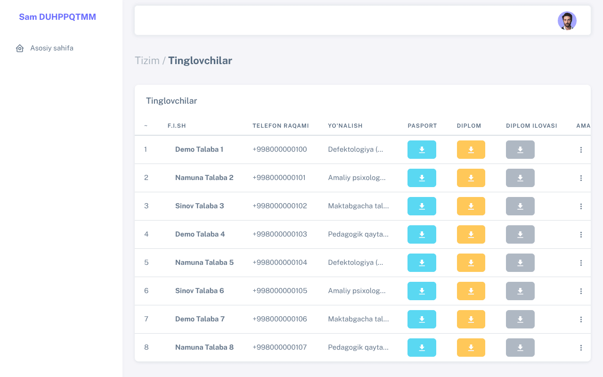
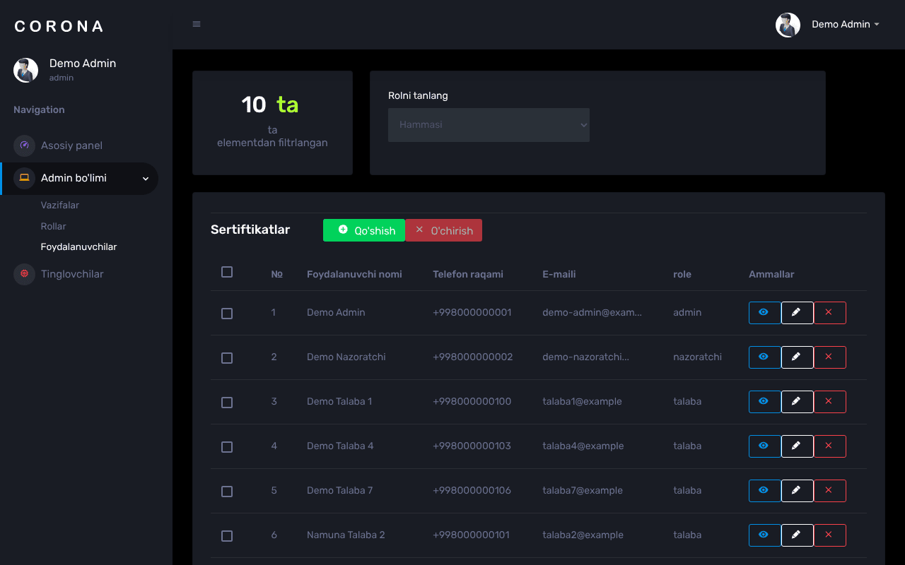
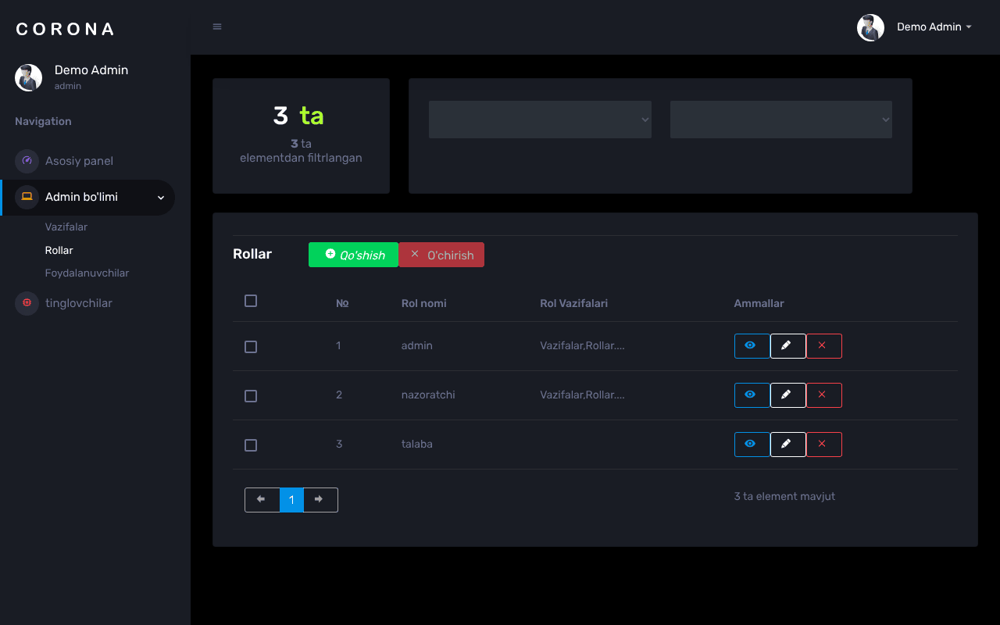
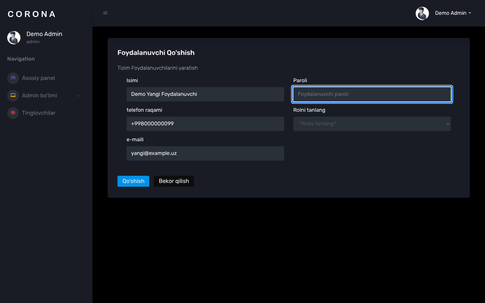
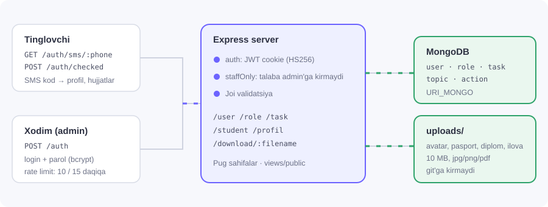

<div align="center">

# Mintaqaviy markaz

Samarqand davlat universiteti huzuridagi malaka oshirish mintaqaviy markazi uchun boshqaruv tizimi: xodimlar, rollar, vazifalar va tinglovchilar hujjatlari.


[Ko'rinish](#korinish) ·
[Qanday ishlaydi](#qanday-ishlaydi) ·
[API](#yonalishlar) ·
[Ishga tushirish](#ishga-tushirish) ·
[Xavfsizlik](#xavfsizlik-va-cheklovlar) ·
[Optimizatsiya](#optimizatsiya-oldin-va-keyin)



</div>

> [!NOTE]
> Screenshot va GIF'dagi barcha ism, telefon va e-pochtalar o'ylab topilgan demo ma'lumot (`Demo Talaba 1`, `+998000000100`, `@example.uz`). Ular bir martalik xotiradagi bazada yaratilgan.

## Ko'rinish

| Asosiy panel | Tinglovchilar |
|---|---|
|  |  |
| **Foydalanuvchilar** | **Rollar** |
|  |  |

<details>
<summary>Foydalanuvchi qo'shish formasi</summary>



</details>

## Qanday ishlaydi



- **Tinglovchi** telefon raqamini kiritadi va SMS kod oladi. Kod to'g'ri bo'lsa, tizim uni "talaba" roli bilan ro'yxatdan o'tkazadi. Keyin u profilida surat, pasport, diplom va ilovani yuklaydi.
- **Xodim** login va parol bilan kiradi. Parol bcrypt bilan tekshiriladi.
- Sessiya `x-web-token` cookie'sida saqlanadi: JWT, HS256, `httpOnly`, `sameSite=lax`.
- `/user`, `/role`, `/task` va `/student` bo'limlariga faqat xodimlar kira oladi. Talaba roli bilan kirilsa, 403 qaytadi.

## Yo'nalishlar

| Yo'nalish | Usul | Kim | Vazifasi |
|---|---|---|---|
| `/login` | GET | hamma | Kirish sahifasi (SMS orqali) |
| `/auth` | POST | hamma | Login + parol, 15 daqiqada 10 urinish |
| `/auth/sms/:phone` | GET | hamma | SMS kod yuborish (5 urinish) |
| `/auth/checked` | POST | hamma | Kodni tekshirish (20 urinish) |
| `/signout` | any | hamma | Cookie'ni tozalash |
| `/` | GET | kirgan | Asosiy panel |
| `/profil`, `/profil/save` | GET, POST | kirgan | Profil va hujjat yuklash (10 MB, jpg/png/pdf) |
| `/download/:filename` | GET | kirgan | `uploads/` dan fayl (yo'l qismi bo'lsa 400) |
| `/user/*` | GET/POST/PUT/DELETE | xodim | Foydalanuvchilar CRUD |
| `/role/*` | GET/POST/DELETE | xodim | Rollar CRUD |
| `/task/*` | GET/POST/PUT/DELETE | xodim | Vazifalar CRUD |
| `/student` | GET | xodim | Tinglovchilar ro'yxati |

## Ishga tushirish

Talablar: Node.js 18+ va MongoDB (Atlas yoki lokal).

```bash
git clone https://github.com/AbduazizBobomalikovNode/Mintaqaviy-markaz.git
cd Mintaqaviy-markaz
npm install
cp .env.example .env   # qiymatlarni to'ldiring
npm start              # http://localhost:1230
```

```bash
npm test               # 25 ta unit test (node:test)
```

| O'zgaruvchi | Majburiy | Vazifasi |
|---|---|---|
| `URI_MONGO` | ha | MongoDB ulanish manzili |
| `JWT_MY_KEY` | ha | JWT imzolash uchun uzun tasodifiy kalit |
| `NODE_ENV` | yo'q | `production` bo'lsa, cookie `secure` bo'ladi va loglar qisqaradi |
| `PORT` | yo'q | Standart qiymati `1230` |
| `SMS_URL`, `SMS_AUTH` | yo'q | SMS xizmati manzili va avtorizatsiya sarlavhasi |
| `SUPPORT_PHONE` | yo'q | Profil sahifasidagi yordam raqami |

`URI_MONGO` yoki `JWT_MY_KEY` berilmasa, server o'zbekcha xato chiqaradi va to'xtaydi.

## Xavfsizlik va cheklovlar

> [!WARNING]
> Repo tarixida avval kodga yozilgan MongoDB Atlas URI (parol bilan), JWT kaliti va SMS avtorizatsiya sarlavhasi, shuningdek `uploads/` dagi shaxsiy hujjatlar qolgan. Hozirgi kodda ularning birortasi yo'q, lekin **parollar va kalitlarni almashtirish** va tarixni `git filter-repo` bilan tozalash kerak.

Endi himoyalangan:
- `/download` faqat kirgan foydalanuvchiga ochiq va `uploads/` dan tashqariga chiqa olmaydi.
- `node_modules`, `gulp-tasks`, `pages`, `package.json` va `.pug` fayllar brauzerga berilmaydi.
- Kirish so'rovlari faqat string qabul qiladi. Bu NoSQL injection'ni (`{"$ne":null}`) yopadi.
- SMS kod `crypto.randomInt` bilan yaratiladi va tekshirishda doimiy vaqtli taqqoslash ishlatiladi.
- Parol xeshi JWT'ga ham, javoblarga ham kirmaydi. Yangi va o'zgartirilgan parollar bcrypt bilan saqlanadi.
- `X-Content-Type-Options`, `X-Frame-Options` va `Referrer-Policy` sarlavhalari qo'yildi, so'rov hajmi 1 MB bilan cheklandi.

Hali qolgan:
- **Rol huquqlari to'liq tekshirilmaydi.** Faqat "xodim yoki talaba" ajratiladi, rolga biriktirilgan yo'llar hisobga olinmaydi.
- **Eski parollar.** Bazada ochiq saqlangan eski parollar hali qabul qilinadi va birinchi kirishda xeshlanadi.
- **Sertifikat yaratish ulanmagan.** `resurs/functions/pdf.js` va `routers/______certificate.js` (docxtemplater + QR) bor, lekin router `index.js` ga ulanmagan. `routers/topic.js` va `device_has_topic.js` ham ulanmagan.
- **Rate limit xotirada ishlaydi.** U `req.ip` bo'yicha sanaydi, shuning uchun reverse proxy ortida `app.set('trust proxy', …)` kerak.
- **`npm audit` (prod): 5 ta topilma.** `xmldom` (`docxtemplater-image-module-free` orqali) uchun tuzatish yo'q. `tar` faqat `bcrypt@6` da tuzatilgan, bu breaking change. `multer@1` eskirgan.
- **CDN.** Kirish sahifasi flowbite/tailwind'ni CDN'dan yuklaydi, internet bo'lmasa sahifa uslubsiz ko'rinadi.
- **Ikki xil dizayn.** Admin qismi to'q rangli "Corona" shablonida, tinglovchilar qismi esa och rangli panelda.

## Optimizatsiya: oldin va keyin

| Ko'rsatkich | Oldin | Keyin |
|---|---|---|
| Git'dagi fayllar | 18 784 | **1 241** |
| `views/public/node_modules` repoda | 17 542 fayl, 164 MB (ishlatilmaydi) | **chiqarildi**, `.gitignore` da |
| `setInterval(…, 100)` bilan bazani kutish | 3 joyda, doimiy | **0**: ulanish bir marta, keyin `listen` |
| `/user` ro'yxati uchun DB so'rovlari | 18 | **3** |
| Rollar ro'yxati (15 rol) | ~62 | **4** |
| Login | har vazifa uchun alohida so'rov | **5** (o'zgarmas) |
| Kodga yozilgan sirlar | 5 | **0** |
| Unit testlar | 0 | **25** |
| `lang="uz"` | yo'q | **28 sahifada** |
| Doim yashil "online" belgilari | 24 | **0** |

Boshqa o'zgarishlar:
- `generateId()` `await` siz chaqirilgan edi, shu sababli foydalanuvchi qo'shishda jarayon qulardi. Tuzatildi.
- Async xatolar umumiy xato ishlovchisiga yo'naltirildi, brauzerga stack trace chiqmaydi.
- `:focus-visible` va `prefers-reduced-motion` qo'shildi (`views/public/asserts/css/a11y.css`).
- 37 ta ikonka tugmaga `aria-label` qo'yildi.

## Loyiha tuzilishi

```
index.js                 server, middleware, /download
db/mongodb.js            ulanish (URI_MONGO)
db/tables/*.js           kolleksiyalar bilan ishlash
middlewire/auth.js       JWT tekshiruvi, staffOnly
middlewire/rateLimit.js  xotiradagi rate limiter
routers/                 auth, user, role, task, student, profil (+ ulanmagan ______*.js)
resurs/functions/        env, password, safePath, getid, pdf, formatDoc …
resurs/validate/         Joi sxemalari
resurs/template/         sertifikat .docx shablonlari
views/                   Pug sahifalar, views/public — statik fayllar
test/                    node:test unit testlari
uploads/                 yuklangan fayllar (git'ga kirmaydi)
```

## Litsenziya

Repoda litsenziya fayli yo'q. `package.json` da `ISC` ko'rsatilgan. Admin interfeysi uchinchi tomon shablonlari asosida qilingan, ularning litsenziyasi `views/public` ichidagi fayllarda.

## Muallif

**Bobomalikov Abduaziz** · GitHub [@AbduazizBobomalikovNode](https://github.com/AbduazizBobomalikovNode) · tashkilot [abdusoft-uz](https://github.com/abdusoft-uz)
